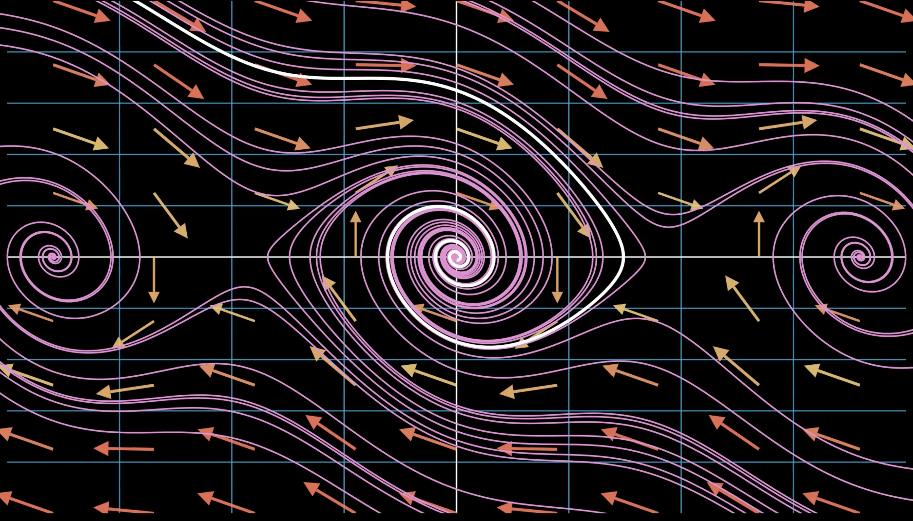

# Candido Manuel Seneriches IV

My name is Candido Manuel Seneriches IV, and I'm a current math undergraduate student at the University of California, Riverside, with emphasis on Computational Mathematics. In the future, I hope to specialize in scientific computing, machine learning, and other applications of math to engineering and computer science.

## Areas of Interest
- Scientific Computing
- Numerical Analysis
- Differential Equations and Dynamical Systems
- Applied Machine Learning/Deep Learning/Artificial Intelligence

## Tools
- Programming Languages: Python, C++, MATLAB
- ML: PyTorch

## Featured Projects
- [**ODE Phase Portraits Gallery**](https://github.com/CandidoS391/phase-portraits-gallery): Explores the mathematics and the resulting art and beauty of phase portraits that arise from various differential equations, using Python, and more specifically a math visualization package called Manim.
- [**Lorenz Attractor Gallery**](https://github.com/CandidoS391/lorenz-attractor): Using Python/Manim, a system of nonlinear differential equations that make up what is known as the Lorenz Attractor are numerically simulated, with multiple nearby trajectories rendered to demonstrate sensitive dependence on initial condition - or in other words to demonstrate the mathematical basis of chaos theory.
- [**Activation/Initialization Functions, and mini-batch SGD Investigation**](https://github.com/CandidoS391/Machine-Learning-Optimization-Initialization): Focusing on the training behavior of Convolutional Neural Networks (CNNs), this investigation focuses on two different, yet essential aspects of training CNNs. The first focuses on how activation functions (ReLU, Leaky ReLU, PReLU) and weight initialization methods (Xavier and He Initialization) affect the training behavior of a convolutional neural network on the CIFAR-10 dataset. The second examines the effects of minibatch size on the training performance and computational efficiency of a convolutional neural network using the CIFAR-100 dataset, and whether or not learning-rate scaling or warmup can compensate for the reduced number of parameter updates associated with larger-minibatches.
- [**Learning Under Transformation Machine Learning Investigation**](https://github.com/CandidoS391/learning-under-transformation): Measured the performance of Convolutional Neural Networks (CNNs) when training on altered data, including various data augmentation methods (AutoAugment, RandAugment, mixup), as well as adversarial examples (Fast Gradient Sign Method, Projected Gradient Descent). 

## Contacts
- [**LinkedIn**](https://www.linkedin.com/in/candido-seneriches-iv-483860389/)
